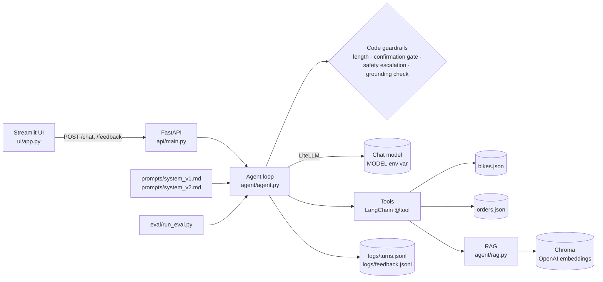

# Bike Support Agent (demo)

A small customer-support agent for **Ferro Cycles**, a fictional direct-to-consumer bike brand.
Built as an interview demo. **All bikes, orders and policies are fictional, hand-written mock data.**

It shows: tool calling, RAG with model-year and policy-version handling, a human confirmation gate
before actions, code guardrails, an eval set with prompt versioning (v1 → v2), latency/token/cost
logging, a REST API, and a chat UI with thumbs up/down feedback.

## Architecture



| Path | What it does |
|---|---|
| `agent/tools.py` | `get_bike_spec`, `check_compatibility`, `get_order_status`, `search_support_docs`, `start_return` |
| `agent/agent.py` | One `handle_turn()` per message: guardrails → gate → tool loop (max 5) → grounding check → log |
| `agent/guardrails.py` | Small pure functions: confirm/cancel rules, safety keywords, number grounding, PII masking |
| `agent/rag.py` | Loads `data/docs/*.md` into Chroma; filters out superseded policies by date |
| `eval/` | 24 cases, deterministic checks, `--repeat` runs, v1 vs v2 results |

## How to run

```bash
uv venv --python 3.11 && uv pip install -r requirements.txt
cp .env.example .env                        # add OPENAI_API_KEY
.venv/bin/python -m agent.rag               # build the doc index (once)

.venv/bin/python -m agent.agent             # terminal chat, or:
.venv/bin/uvicorn api.main:app --reload     # API on :8000
.venv/bin/streamlit run ui/app.py           # UI (API_URL defaults to http://localhost:8000)

.venv/bin/pytest tests/                     # 83 unit tests, no API calls
.venv/bin/python -m eval.run_eval --prompt v2 --repeat 3
.venv/bin/python -m eval.compare v1 v2
```

Default model: `openai/gpt-6-luna`. Switching to Azure OpenAI only needs `MODEL=azure/<deployment>` plus credentials.

## Eval results: v1 vs v2

24 cases × 3 runs per prompt, same code, model `gpt-6-luna`. Only the system prompt differs.

| Metric | v1 | v2 |
|---|---|---|
| Cases passed | 66/72 (92%) | **71/72 (99%)** |
| `start_return` only when the user asks for a return | 30/33 (91%) | **33/33 (100%)** |
| No unneeded tool calls (per turn) | 27/33 (82%) | **32/33 (97%)** |
| Tool selection accuracy | 51/51 | 51/51 |
| Asks for model year when needed | 6/6 | 6/6 |
| Confirmation gate (blocked / executed / kept / cleared) | 48/48 | 48/48 |
| Abstains on unknown model / order | 6/6 | 6/6 |
| Refuses off-topic and prompt injection | 6/6 | 6/6 |
| Safety escalation | 3/3 | 3/3 |
| No promises of refunds, discounts or dates | 6/6 | 6/6 |
| Latency avg / p95 per turn | 2919 / 6158 ms | **2842 / 5486 ms** |

What v2 fixed (both failed in 3/3 v1 runs):
- A policy question ("how many days do I have to return?") made v1 start a return. v2 answers and offers one.
- v1 called `get_order_status` before `start_return`, although `start_return` checks the order itself.

**Honest notes**
- The model is not deterministic: one v1 run scored 21/24 and another 23/24. That is why results are reported over 3 runs.
  v2 still has one flaky case (1/3: an extra spec tool call).
- The first eval scored v1 at 19/19. Reading the answers showed real problems the checks missed, so I **tightened the eval
  after seeing v1 results** (per-turn tool checks, return-intent and pending-state checks), then wrote v2.
- Scoring is deterministic (regex and session state, no LLM judge): cheap and reproducible, but it checks
  keywords, not answer quality.

## Design decisions

- **The model explains, code enforces.** Anything with consequences (executing a return, eligibility, safety
  handover, numbers in answers) is decided in code. The prompt only shapes wording and tool choice.
- **Confirmation gate.** `start_return` only stores a pending action. The next message is checked in code:
  exact "yes" executes; "no"/"cancel" cancels; a question or "yes but…" keeps it pending and asks again;
  it expires after 2 follow-up turns or on an unrelated request. `start_return` also refuses to run unless
  the user's message asks for a return.
- **The keyword rule errs toward cancelling.** "Related to the pending return" is a keyword check. When it
  is wrong, the return is cancelled rather than executed: the user just asks again.
- **Version filter in retrieval.** Docs carry `valid_from`/`valid_to` (stored as YYYYMMDD integers for Chroma).
  The superseded 14-day returns policy is never retrieved; only the current 30-day one.
- **Model year matters.** Specs differ per year (Strada GX rotor 160 → 180 mm), so the agent asks for the year
  instead of guessing. Unknown models or years return the list of valid ones, never a fuzzy match.
- **Eligibility before reason.** `start_return` checks delivered + 30-day window first, so ineligible customers
  aren't asked for a reason they don't need.
- **Template reply after execution.** The confirmation turn replies from a fixed template: no second model call
  (≈1.7 s → 0 ms, see `eval/latency_return_template.json`) and the return ID can't be misstated.
- **Grounding check.** Numbers with mm/Wh/kg/V/km/days/€ in an answer must appear in that turn's tool results,
  otherwise a safe fallback offers a human.
- **LangChain only where it adds standard interfaces** (retrieval, tool schemas). The agent loop is ~250 lines
  of plain Python so every step is visible and testable.

## What I would add for production

1. Azure OpenAI (data residency, private networking), same code via `MODEL`.
2. Real order and CRM APIs behind authentication instead of JSON files.
3. Webhooks for order events (shipped, delivered) to keep status fresh.
4. Monitoring dashboards on the turn logs, CSAT from real users, and proper PII handling (detection service, retention policy).
5. **Customer verification.** Today anyone who guesses an order ID like `CN-1042` sees its status. Require a second
   detail (e.g. postcode) or a logged-in session.
6. **Idempotency keys in a database.** The demo dedupes returns in memory; production needs a unique key per action.
7. **Timeouts, retries and a fallback message** on model API failure (the demo has a basic version).
8. **Rate limiting per session** so one user can't run up costs.
9. **Handover on frustration:** repeated failures or angry messages route to a human agent.

---
*Fictional brand and data, for demo purposes only.*
