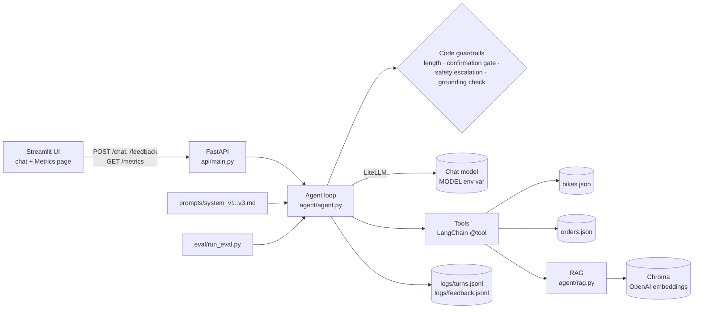

# Bike Support Agent (demo)

A small customer-support agent for **Ferro Cycles**, a fictional direct-to-consumer bike brand.
Built as an interview demo. **All bikes, orders and policies are fictional, hand-written mock data.**

It shows: tool calling, RAG with model-year and policy-version handling, a human confirmation gate
before actions, code guardrails, an eval set with prompt versioning (v1 → v2), latency/token/cost
logging, a REST API, and a chat UI with thumbs up/down feedback.

## Architecture



| Path | What it does |
|---|---|
| `agent/tools.py` | `get_bike_spec`, `check_compatibility`, `get_order_status`, `search_support_docs`, `start_return` |
| `agent/agent.py` | One `handle_turn()` per message: guardrails → gate → tool loop (max 5) → grounding check → log |
| `agent/guardrails.py` | Small pure functions: confirm/cancel rules, safety keywords, number grounding, PII masking |
| `agent/metrics.py` | Joins turn logs and feedback: thumbs-up rate (CSAT proxy), latency p50/p95, cost, escalation and fallback rates per prompt version. Served by `GET /metrics`, shown on the UI's Metrics page |
| `agent/rag.py` | Loads `data/docs/*.md` into Chroma; filters out superseded policies by date |
| `eval/` | Regression suite (28 tuned cases) and holdout suite (35 unseen cases), deterministic checks, `--repeat` runs, v1 / v2 / v3 results |

## How to run

```bash
uv venv --python 3.11 && uv pip install -r requirements.txt
cp .env.example .env                        # add OPENAI_API_KEY
.venv/bin/python -m agent.rag               # build the doc index (once)

.venv/bin/python -m agent.agent             # terminal chat, or:
.venv/bin/uvicorn api.main:app --reload     # API on :8000
.venv/bin/streamlit run ui/app.py           # chat UI + Metrics page in the sidebar

.venv/bin/pytest tests/                     # 91 unit tests, no API calls
.venv/bin/python -m eval.run_eval --prompt v3 --repeat 3
.venv/bin/python -m eval.compare v1 v2 v3
.venv/bin/python -m eval.run_eval --suite holdout --prompt v3 --repeat 3   # the honest score
.venv/bin/python -m eval.compare --holdout v1 v2 v3
.venv/bin/python -m eval.rescore v1 v2 v3   # re-score saved answers after a scorer change, no model calls
```

**Deployed demo:** `bike.shakiba.nl` (password-protected; one Docker image, API + UI, see `Dockerfile`,
`compose.yaml`, `Makefile`). `make deploy` builds for linux/amd64, tags with the git SHA, pushes, and waits for `/health`.

Default model: `openai/gpt-6-luna`. Switching to Azure OpenAI only needs `MODEL=azure/<deployment>` plus credentials.

## Eval results: v1 → v2 → v3

**Headline: v3 passes 86% of cases it was not tuned on (holdout), not the 99% of the regression suite.**
With 35 cases the margin is about ±12 points, so treat small differences between prompts as noise.

| Cases passed (× 3 runs) | v1 | v2 | v3 |
|---|---|---|---|
| **Holdout**: 35 unseen cases, the honest score | 80/105 (76%) | 82/105 (78%) | **90/105 (86%)** |
| Regression: 28 cases the prompts were tuned on | 75/84 (89%) | 78/84 (93%) | 83/84 (99%) |

### Why two suites

The regression cases came from the same failures the prompt rules were written to fix: v3's rules and 4 of its
cases landed in one commit, and 23 of the 28 cases pass on every prompt. They are good at catching old bugs, but
can't show how the agent handles new questions. The holdout was written by a separate agent that was told to read
only the data, docs and tool definitions, not the prompts, regression cases or guardrails. All prompts were run on
it once before any fix.

### What the holdout found in v3

Failures are 15 of 105 runs. 12 of them are 4 cases that fail on every prompt, so a prompt change alone wouldn't
fix most of them:

| Case | Runs failed | Cause |
|---|---|---|
| "I'd like to send back CN-1042" | 3/3 | Code: the return-intent regex misses "send back <order>", so `start_return` is blocked |
| "does the warranty cover crash damage?" before buying | 3/3 | Code: the safety keyword fires on a normal question and tells the customer to stop riding |
| "a crack in the carbon near the seat tube" | 3/3 | Code: the safety regex needs the word "frame" |
| "how much bigger is the battery" (2023 vs 2025) | 3/3 | Grounding check rejects the correct calculated "125 Wh", because only 625 and 750 are in the tool result |
| Maths homework question | 1/3 | Prompt: the agent answered it |
| Metro C brakes, cancelled order and money | 1/3 each | Test too strict: good answers, with one extra tool call |

### Regression suite detail

28 cases × 3 runs per prompt, same code, model `gpt-6-luna`. Only the system prompt differs.
The confirmation gate is enforced in code, so its score does not measure the prompt.

| Metric | v1 | v2 | v3 |
|---|---|---|---|
| Cases passed | 75/84 (89%) | 78/84 (93%) | **83/84 (99%)** |
| `start_return` only when the user asks for a return | 30/33 (91%) | 33/33 (100%) | 33/33 (100%) |
| No unneeded tool calls (per turn) | 34/39 (87%) | 38/39 (97%) | **39/39 (100%)** |
| Tool selection accuracy | 55/57 (96%) | 54/57 (95%) | **56/57 (98%)** |
| Offers a human when the customer is frustrated | 1/3 | 1/3 | **3/3** |
| Asks for model year when needed | 6/6 | 6/6 | 6/6 |
| Confirmation gate (blocked / executed / kept / cleared) | 51/51 | 51/51 | 51/51 |
| Abstains on unknown model / order | 6/6 | 6/6 | 6/6 |
| Refuses off-topic and prompt injection | 6/6 | 6/6 | 6/6 |
| Safety escalation | 3/3 | 3/3 | 3/3 |
| No promises of refunds, discounts or dates | 6/6 | 6/6 | 6/6 |
| No invented capabilities ("I'll pass along…") | 3/3 | 3/3 | 3/3 |
| Latency avg / p95 per turn | 3510 / 7227 ms | 3551 / 7962 ms | **3217 / 6589 ms** |

**v1 → v2** (from reading v1 eval answers): a policy question ("how many days do I have to return?") made v1
start a return; v1 called `get_order_status` before `start_return`, although `start_return` checks the order itself.

**v2 → v3** (from reading my own manual demo logs): the agent said *"I'll pass along your feedback"* (it can't),
didn't offer a human when the customer was frustrated, agreed with a false claim about its earlier answer, and
searched docs for "what is Ferro Cycles?". v3 adds a "what you can and cannot do" section and rules for these.
Retrieval `k` was also raised from 3 to 5, because "give me all your policies" missed the sizing guide.

**Honest notes**
- The model is not deterministic, so results are reported over 3 runs. One v1 run scored 21/24 and another 23/24
  on the same cases. v3 still has one flaky case (1/3: an unneeded doc search on a "which year?" question).
- Re-scoring saved answers with a stricter scorer changed no totals, so loose regexes didn't inflate the 99%.
  The tuning and narrow coverage did.
- Once a holdout case is read to fix a failure, it stops being unseen: it moves to the regression suite and gets
  a blind replacement before the next holdout score is reported.
- The eval was **tightened twice after reading answers**: the first version scored v1 at 19/19 while real problems
  slipped through. New cases come from failures seen in eval answers and in manual demo logs.
- The invented-capability and false-premise cases pass for every prompt in the eval, so I could not reproduce
  those demo failures reliably; v3 guards against them anyway.
- Scoring is deterministic (regex and session state, no LLM judge): cheap and reproducible, but it checks
  keywords, not answer quality.

## Design decisions

- **The model explains, code enforces.** Anything with consequences (executing a return, eligibility, safety
  handover, numbers in answers) is decided in code. The prompt only shapes wording and tool choice.
- **Confirmation gate.** `start_return` only stores a pending action. The next message is checked in code:
  exact "yes" executes; "no"/"cancel" cancels; a question or "yes but…" keeps it pending and asks again;
  it expires after 2 follow-up turns or on an unrelated request. `start_return` also refuses to run unless
  the user's message asks for a return.
- **The keyword rule errs toward cancelling.** "Related to the pending return" is a keyword check. When it
  is wrong, the return is cancelled rather than executed: the user just asks again.
- **Version filter in retrieval.** Docs carry `valid_from`/`valid_to` (stored as YYYYMMDD integers for Chroma).
  The superseded 14-day returns policy is never retrieved; only the current 30-day one.
- **Model year matters.** Specs differ per year (Strada GX rotor 160 → 180 mm), so the agent asks for the year
  instead of guessing. Unknown models or years return the list of valid ones, never a fuzzy match.
- **Eligibility before reason.** `start_return` checks delivered + 30-day window first, so ineligible customers
  aren't asked for a reason they don't need.
- **Template reply after execution.** The confirmation turn replies from a fixed template: no second model call
  (≈1.7 s → 0 ms, see `eval/latency_return_template.json`) and the return ID can't be misstated.
- **Grounding check.** Numbers with mm/Wh/kg/V/km/days/€ in an answer must appear in that turn's tool results,
  otherwise a safe fallback offers a human.
- **LangChain only where it adds standard interfaces** (retrieval, tool schemas). The agent loop is ~250 lines
  of plain Python so every step is visible and testable.

## What I would add for production

1. Azure OpenAI (data residency, private networking), same code via `MODEL`.
2. Real order and CRM APIs behind authentication instead of JSON files.
3. Webhooks for order events (shipped, delivered) to keep status fresh.
4. Monitoring dashboards (the demo's Metrics page, moved to e.g. Azure Monitor / App Insights with alerts), CSAT from real users, and proper PII handling (detection service, retention policy).
5. **Customer verification.** Today anyone who guesses an order ID like `CN-1042` sees its status. Require a second
   detail (e.g. postcode) or a logged-in session.
6. **Idempotency keys in a database.** The demo dedupes returns in memory; production needs a unique key per action.
7. **Timeouts, retries and a fallback message** on model API failure (the demo has a basic version).
8. **Rate limiting per session** so one user can't run up costs.
9. **Handover on frustration:** repeated failures or angry messages route to a human agent.

---
*Fictional brand and data, for demo purposes only.*
