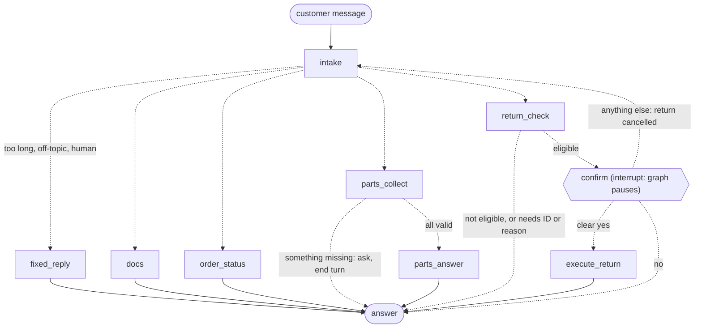

# Bike Support Agent (demo)

A small customer-support agent for **Ferro Cycles**, a fictional direct-to-consumer bike brand.
Built as an interview demo. **All bikes, orders and policies are fictional, hand-written mock data.**

It shows: a LangGraph workflow where the model labels and extracts and code decides, RAG with model-year and
policy-version handling, a human confirmation pause before actions, an eval set with a blind holdout, Langfuse tracing,
latency/token/cost logging, a REST API, and a chat UI with thumbs up/down feedback.

## Architecture

The first version was a hand-written agent loop where the model chose tools. Most of its failures came from code
guessing around the model (return-intent and safety regexes, session flags), so this version moves routing into a
graph. The numbers are under [Eval results](#eval-results-agent-loop--graph).



| Node | Model? | What it does |
|---|---|---|
| `intake` | intent label | Length check, then one label: continue, docs, parts, order, return, human, other. A new task clears old slots |
| `fixed_reply` | no | Templates for too long, off-topic and human handover |
| `docs` | rewrite + answer | Standalone question, currently valid chunks only, answer with chunk IDs that code validates and renders as citations |
| `parts_collect` | extraction | Model, year, attribute, part. Asks for one missing or invalid field and ends the turn, keeping the rest |
| `parts_answer` | no | Fills the answer from the catalogue, so a number can't be invented. Keeps the bike for follow-ups |
| `order_status` | no | Order ID by regex, status from the data |
| `return_check` | extraction | Order ID, eligibility in code, then the reason. Changes nothing |
| `confirm` | reply label | The one place the graph pauses. Only a clear yes continues |
| `execute_return` | no | The only node that changes anything. Re-checks eligibility, idempotent |

| Path | What it does |
|---|---|
| `agent/graph.py` | The nodes and the graph |
| `agent/agent.py` | `handle_turn()`: start or resume the graph, trace it, log the turn |
| `agent/llm.py` | The one model call, through LiteLLM, validated against a schema |
| `agent/tools.py` | Catalogue, order and return operations, called by nodes |
| `agent/tracing.py` | Langfuse: one trace per message, PII masked, framework objects made readable, feedback as scores |
| `agent/rag.py` | Loads `data/docs/*.md` into Chroma; filters out superseded policies by date |
| `agent/metrics.py` | Thumbs-up rate, latency, cost and fallback rates from the logs, shown on the UI's Metrics page |
| `prompts/graph_v2/` | One prompt per model call (`graph_v1` is the scored version). `prompts/system_v*.md` belong to the old loop |
| `eval/` | Regression and blind holdout suites, deterministic checks, saved results |

## How to run

```bash
uv venv --python 3.11 && uv pip install -r requirements.txt
cp .env.example .env                        # add OPENAI_API_KEY; Langfuse keys are optional
.venv/bin/python -m agent.rag               # build the doc index (once)

.venv/bin/python -m agent.agent             # terminal chat, or:
.venv/bin/uvicorn api.main:app --reload     # API on :8000
.venv/bin/streamlit run ui/app.py           # chat UI + Metrics page in the sidebar

.venv/bin/pytest tests/                     # 90 unit tests, no API calls
.venv/bin/python -m eval.run_eval --suite holdout --prompt graph_v1 --repeat 3   # the honest score
.venv/bin/python -m eval.run_eval --prompt graph_v2 --repeat 3                   # regression
.venv/bin/python -m eval.compare --holdout loop_v3 graph_v1
```

**Deployed demo:** `bike.shakiba.nl` (password-protected; one Docker image, API + UI, see `Dockerfile`,
`compose.yaml`, `Makefile`). `make deploy` builds for linux/amd64, tags with the git SHA, pushes, and waits for `/health`.

Default model: `openai/gpt-6-luna`. Switching to Azure OpenAI only needs `MODEL=azure/<deployment>` plus credentials.

## Eval results: agent loop → graph

**Headline: on 35 cases neither version was written against, the graph passes 91% and the old agent loop 83%.**
With 35 cases the margin is about ±10 points, so this shows no loss rather than proving a large gain.

| 35 blind holdout cases × 3 runs | Agent loop (prompt v3) | Graph (`graph_v1`) |
|---|---|---|
| **Cases passed** | 87/105 (83%) | **96/105 (91%)** |
| Passed per run | 29, 28, 30 | 32, 32, 32 |
| Latency avg / p95 per turn | 3329 / 4881 ms | **2323 / 3929 ms** |
| Offers a human when it should | 7/9 | 9/9 |
| Confirmation gate | 21/21 | 21/21 |
| Abstains on unknown data | 11/12 | **9/12 (worse)** |

The holdout was written by a separate agent that could read only the data and docs, not the code, prompts or other
cases. Both versions ran on it once, and nothing was tuned on it. Every graph run passed the same 32 cases, while the
loop's results varied, because code now makes the decisions that varied.

### What the holdout found in the graph

All 9 failed runs are 3 cases. They moved to regression, so the holdout now has 32 cases and needs 3 blind replacements
before its next score.

| Case | Cause | Status |
|---|---|---|
| "Ridge E, not sure which year, just want the clearance" | Asks for the year even though the value is the same in both years | Open |
| "I bought a Strada GX in 2019" | The year of purchase isn't taken as the model year, so it asks rather than saying 2019 isn't listed | Open |
| Refused return, then "yes please go ahead" | The bot offered a human, the customer said yes, and it answered "I can't help with that" | Fixed in `graph_v2` |

**The deployed version is `graph_v2`:** `graph_v1` plus one router rule for that bug. The 91% above is `graph_v1`;
`graph_v2` hasn't had a blind holdout score.

### Regression

`graph_v2`, 65 cases × 1 run: 63/65 (97%), latency avg / p95 2434 / 5414 ms. The two failures are the open cases above.
(`graph_v1` passed 186/186 over 3 runs on the earlier 62 cases.) Cases were edited after a first run on this suite, so
this only shows that old bugs haven't come back. It says little about new questions.

The regression suite holds cases that have been seen: the old loop's tuned cases plus the first holdout. Cases changed
where behaviour changed on purpose: a question during the pause cancels the return, comparisons answer one year, and
damage reports hand over instead of running a separate safety check. Scores from before the rewrite are kept in
`eval/results_v*.json` and `eval/results_old_holdout_v*.json`. They aren't comparable with this suite.

## Design decisions

- **The model labels and extracts, code decides.** Routing, eligibility, slots and most replies are code. Model output
  must fit a schema, and a label can only choose between paths that already exist.
- **Confirmation pause.** A LangGraph interrupt pauses the graph. A small model call labels the reply, and only a clear
  yes reaches `execute_return`. Anything else cancels and goes through `intake`, so length checks still apply. A failed
  model call never executes. Trade-off: "does shipping cost anything?" cancels the return, so the customer has to ask again.
- **No separate safety check.** The keyword check missed "crack in the carbon" and fired on warranty questions. The router
  now sends damage, injury and battery hazards to the human handover. Trade-off: if the router misses one, nothing catches it.
- **Answers from data.** Spec and order answers are templates filled from the catalogue. Only `docs` has the model write
  free text, so that's where the citation check and number grounding check run.
- **Citations checked in code.** The model returns the chunk numbers it used. No valid number means "I don't know".
- **Version filter in retrieval.** Docs carry `valid_from`/`valid_to`. The superseded 14-day returns policy is never retrieved.
- **Model year matters.** Specs differ per year, so it asks instead of guessing. Unknown models or years list the valid
  ones, never a fuzzy match.
- **Eligibility before reason.** Ineligible customers aren't asked for a reason they don't need.
- **Tracing shows decisions.** One Langfuse trace per message, grouped by session. Spans show what each node decided,
  not the whole graph state, and thumbs up/down are scores on the trace. Tracing is off in tests and evals.
- **Limitation: handover is only a message.** There are no tickets, so the reply gives a support address.

## What I would add for production

1. Azure OpenAI (data residency, private networking), same code via `MODEL`.
2. Real order and CRM APIs behind authentication instead of JSON files.
3. Webhooks for order events (shipped, delivered) to keep status fresh.
4. Monitoring dashboards (the demo's Metrics page, moved to e.g. Azure Monitor / App Insights with alerts), CSAT from real users, and proper PII handling (detection service, retention policy).
5. **Customer verification.** Today anyone who guesses an order ID like `CN-1042` sees its status. Require a second
   detail (e.g. postcode) or a logged-in session.
6. **Idempotency keys in a database.** The demo dedupes returns in memory; production needs a unique key per action.
7. **Timeouts, retries and a fallback message** on model API failure (the demo has a basic version).
8. **Rate limiting per session** so one user can't run up costs.
9. **Real handover:** tickets in a support system, instead of a message with an address.
10. **Postgres checkpointer**, so paused returns survive a restart (the demo keeps state in memory).

---
*Fictional brand and data, for demo purposes only.*
